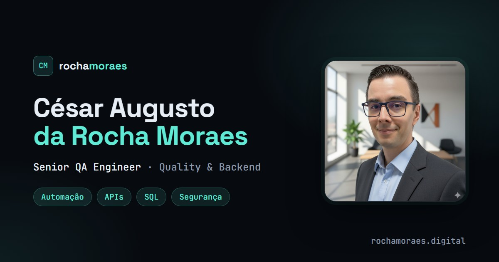

# rochamoraes.digital

[](https://rochamoraes.digital)

Site pessoal de **César Augusto da Rocha Moraes**, Senior QA Engineer com mais de 15 anos em tecnologia, unindo Quality Engineering, segurança de aplicações, automação, APIs, SQL e backend.

🔗 **https://rochamoraes.digital**

[](https://github.com/rochamoraes/rochamoraes.github.io/actions/workflows/deploy.yml)

## Ferramentas

As ferramentas que uso no dia a dia, como aparecem na seção *Foco técnico* do site:

| Grupo | Ferramentas |
|---|---|
| Automação de testes | Playwright, Selenium, Appium, TestComplete |
| APIs e desempenho | Postman, Insomnia, Apache JMeter |
| Dados, infra e depuração | SQL Server, PostgreSQL, Docker, Chrome DevTools |
| Versionamento e gestão | Git, GitHub, GitLab, Jira, Freshdesk |

A lista do site fica em [`src/components/Skills.jsx`](src/components/Skills.jsx), e as ferramentas de cada experiência em [`src/data/experience.js`](src/data/experience.js).

## Tecnologias do site

- [React](https://react.dev) 18
- [Vite](https://vitejs.dev) 8
- GitHub Pages + GitHub Actions

## Rodando localmente

Requer [Node.js](https://nodejs.org) 20.19+ ou 22.12+.

```bash
npm install
npm run dev
```

O site abre em http://localhost:5173.

| Comando | Descrição |
|---|---|
| `npm run dev` | Servidor de desenvolvimento |
| `npm run build` | Gera a versão de produção em `dist/` |
| `npm run preview` | Serve localmente o conteúdo de `dist/` |
| `npm run lint` | Verifica o código com ESLint (regras em [`eslint.config.js`](eslint.config.js)) |

## Deploy

Cada push na branch `main` dispara o workflow [`deploy.yml`](.github/workflows/deploy.yml), que roda o lint, gera o build e publica no GitHub Pages. Se o lint falhar, o deploy é interrompido e o site continua na versão anterior. O domínio personalizado é definido em [`public/CNAME`](public/CNAME).

## Prévia de link

Ao compartilhar o site no LinkedIn, WhatsApp, X e afins, a prévia usa as tags Open Graph e Twitter do [`index.html`](index.html) e a imagem [`public/og-image.jpg`](public/og-image.jpg) (1200×630).

A imagem é um arquivo estático: ao mudar nome, cargo ou foto, gere uma nova versão. Para forçar o LinkedIn a buscar a prévia atualizada, use o [Post Inspector](https://www.linkedin.com/post-inspector/).

## Licença

[MIT](LICENSE)
